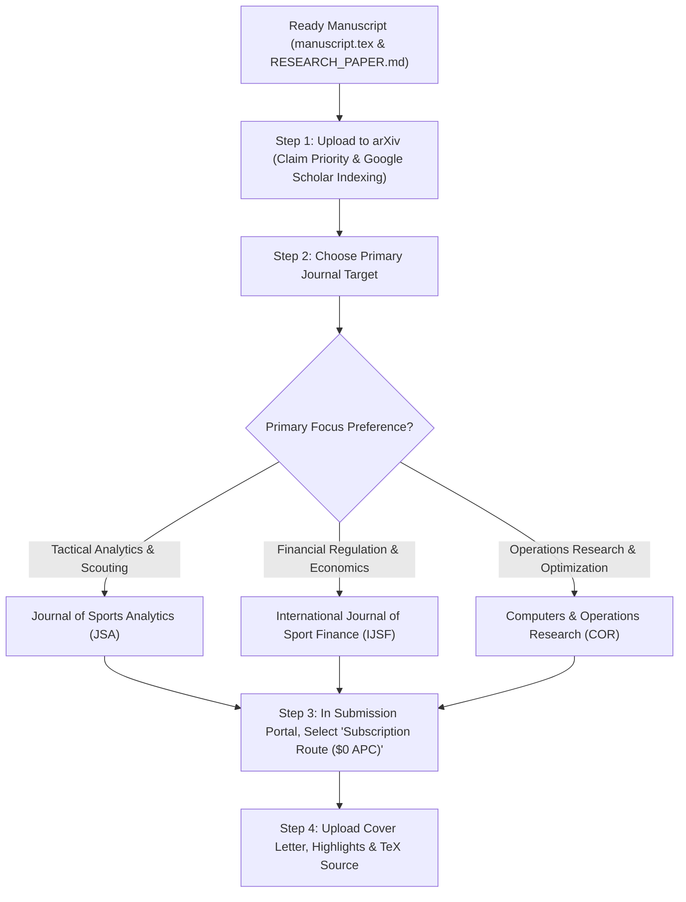

# Academic Publishing Guide: Free Publication ($0 APC) & Submission Dossier

**Paper Title:** *Beyond Transfer Fees: A Constrained Vector Similarity and Machine Learning Framework for Post-Departure Tactical Void Quantification and Regulatory Arbitrage in Association Football*  
**Author:** Readuanul Farid Fahim  
**Affiliation:** Advanced Sports Intelligence & Operations Research Lab  
**Contact:** readuanulfaridfahim@gmail.com  
**Interactive Platform:** [readuanulfaridfahim.github.io/football-transfers-ffp](https://readuanulfaridfahim.github.io/football-transfers-ffp/)  

---

## 1. How to Publish for $0 (Free) in Top Academic Journals

Many researchers mistakenly believe that publishing in top academic journals requires paying thousands of dollars in Article Processing Charges (APCs). In fact, **the vast majority of prestigious peer-reviewed journals published by Elsevier, SAGE, Springer Nature, and IOS Press offer completely FREE publication ($0 author cost)** through the **Traditional / Subscription Model**.

### Understanding the Two Publishing Routes:
| Feature | Traditional / Subscription Route (**100% FREE**) | Gold Open Access Route |
| :--- | :--- | :--- |
| **Cost to Author** | **$0.00 (Completely Free)** | $1,500 – $4,000 USD (APC) |
| **Who Pays?** | University libraries & institutional subscribers | The author or author's research grant |
| **Peer Review Quality**| Identical rigorous peer review | Identical rigorous peer review |
| **Indexing** | Scopus, Web of Science, PubMed, Google Scholar | Scopus, Web of Science, PubMed, Google Scholar |
| **How to Select It?** | Select **"Subscription / Traditional / No APC"** during submission portal checkout | Select "Open Access" |

> [!TIP]
> **Key Rule for Zero-Cost Publishing:** When submitting through Elsevier Editorial Manager, SAGE Track (ScholarOne), or Springer Nature portals, you will always reach a step asking: *"Do you want to publish Open Access or Subscription?"* Simply choose **Subscription / Traditional**. The journal will publish your paper **free of charge**.

---

## 2. Top Journals Ranked for this Paper (All $0 Free to Publish)

Because this paper bridges **Machine Learning**, **Sports Analytics**, and **Financial Regulations (FFP/PSR)**, it qualifies for high-impact journals across three distinct academic domains:

### Tier 1: Sports Analytics & Sports Finance (Highest Relevance)

#### 1. **Journal of Sports Analytics (JSA)** — *Top Recommendation*
- **Publisher:** IOS Press / SAGE
- **Publication Cost:** **$0 (Free)** via Traditional/Subscription Route
- **Indexing:** Scopus, Emerging Sources Citation Index (ESCI - Web of Science), Scimago Q2
- **Scope Match:** 10/10. The premier international journal dedicated specifically to tactical football analytics, event data, tracking models, and sports data science. Seminal football papers (e.g., Decroos et al., Franks et al., Salo & Mäkinen) are published and cited here.
- **Review Turnaround:** ~6–10 weeks to first decision.
- **Submission Portal:** [SAGE / IOS Press JSA Portal](https://journals.sagepub.com/home/osa)

#### 2. **International Journal of Sport Finance (IJSF)** — *Best for FFP/Regulatory Focus*
- **Publisher:** FiT Publishing / Official Journal of the European Sport Economics Association (ESEA)
- **Publication Cost:** **$0 (Free)** (No mandatory author submission or publication fee for regular peer-reviewed articles)
- **Indexing:** Social Sciences Citation Index (SSCI - Web of Science Core Collection), Scopus (Q2), EconLit
- **Scope Match:** 9.5/10. Focuses directly on European football finances, UEFA Financial Sustainability Regulations, transfer market equilibrium, and club solvency (Stefan Szymanski regularly publishes here).
- **Review Turnaround:** ~8–12 weeks.
- **Submission Portal:** [IJSF Scholastica Portal](https://ijsf.scholasticahq.com/)

#### 3. **Journal of Sports Economics (JSE)**
- **Publisher:** SAGE Publications
- **Publication Cost:** **$0 (Free)** via Traditional/Subscription Route
- **Indexing:** SSCI (Web of Science Impact Factor ~1.8), Scopus Q1/Q2
- **Scope Match:** 9/10. The leading academic journal for econometrics and player valuation in professional sports, salary structures, and competitive balance.
- **Submission Portal:** [SAGE Track (ScholarOne)](https://mc.manuscriptcentral.com/jse)

---

### Tier 2: Operations Research & Decision Support Systems (Highest Impact Factor)

#### 4. **Computers & Operations Research (COR)** — *Top OR Venue*
- **Publisher:** Elsevier
- **Publication Cost:** **$0 (Free)** via Subscription Route
- **Impact Factor:** 4.6 (Scopus Q1, SCIE Core Collection)
- **Scope Match:** 9/10. Explicitly publishes papers combining combinatorial optimization, knapsack algorithms, and decision heuristics in sports analytics. (Direct precedent: Mercer & Johnson 2021 was published here).
- **Submission Portal:** [Elsevier Editorial Manager](https://www.editorialmanager.com/cor/)

#### 5. **Decision Support Systems (DSS)** or **Expert Systems with Applications (ESWA)**
- **Publisher:** Elsevier
- **Publication Cost:** **$0 (Free)** via Subscription Route
- **Impact Factor:** 7.5+ (Scopus Q1, SCIE)
- **Scope Match:** 8.5/10. Focuses on applied machine learning (CatBoost/LightGBM) and real-time decision-support systems for high-stakes executive operations.
- **Submission Portal:** [Elsevier Editorial Manager (ESWA)](https://www.editorialmanager.com/eswa/)

---

## 3. Instant 100% Free Preprint Priority (arXiv & SportRxiv)

Before or concurrently with journal submission, you should deposit the manuscript on a recognized academic preprint server. This:
1. **Establishes scientific priority** (proves you were first to invent the framework).
2. **Assigns a permanent, citable identifier / DOI**.
3. **Gets indexed on Google Scholar within 24 to 48 hours**.
4. **Is 100% free and permitted by Elsevier, SAGE, Springer, and IEEE**.

### Option A: **arXiv.org** (Cornell University)
- **Category:** `cs.LG` (Computer Science - Learning) or `stat.ML` (Machine Learning) or `econ.GN` (General Economics)
- **Cost:** **$0 (Free)**
- **How to Submit:**
  1. Go to [arxiv.org](https://arxiv.org/) and register an account.
  2. Select "Submit New Article".
  3. Upload `manuscript.tex`, `references.bib`, and the generated figure files.
  4. Select primary category: `cs.LG` or `econ.GN`.
  5. Your paper is published and indexed worldwide within 24-48 hours.

### Option B: **SportRxiv** (Open Science Framework - OSF)
- **Website:** [sportrxiv.org](https://sportrxiv.org/)
- **Cost:** **$0 (Free)**
- **Focus:** Dedicated open-access archive for sports analytics and sports science.

---

## 4. Summary Comparison Matrix

| Journal / Platform | Publisher | APC / Author Fee | Indexing | Impact Factor / CiteScore | Best For |
| :--- | :--- | :---: | :--- | :---: | :--- |
| **Journal of Sports Analytics** | SAGE / IOS Press | **$0** (Subscription) | Scopus, ESCI | CiteScore 2.4 | Direct domain fit (tactical ML) |
| **Int. Journal of Sport Finance** | FiT / ESEA | **$0** (Standard) | SSCI, Scopus | Impact Factor 1.2 | FFP, UEFA regulations & accounting |
| **Journal of Sports Economics** | SAGE | **$0** (Subscription) | SSCI, Scopus | Impact Factor 1.8 | Econometrics & valuation |
| **Computers & Operations Research**| Elsevier | **$0** (Subscription) | SCIE, Scopus Q1 | Impact Factor 4.6 | Constrained optimization / OR |
| **Expert Systems with Applications**| Elsevier | **$0** (Subscription) | SCIE, Scopus Q1 | Impact Factor 7.5 | Applied ML & Decision Systems |
| **arXiv.org** | Cornell | **$0** (Preprint) | Google Scholar | Open Access | Immediate priority & citation |

---

## 5. Step-by-Step Submission Roadmap

### Action Checklist Before Submitting:
- [x] Abstract updated with final empirical metrics ($R^2 = 0.3485$, $\text{MAE} = 0.1542$).
- [x] TikZ System Architecture diagram included (Figure 1).
- [x] SHAP Global Feature Attributions included (Figure 2).
- [x] Pareto Frontier & Arbitrage Gold Zone chart included (Figure 3).
- [x] Full BibTeX bibliography verified (`references.bib`).
- [x] Mandatory Statements added:
  - Data Availability Statement
  - Code & Software Availability
  - Conflict of Interest
  - CRediT Authorship Contributions
  - Funding Statement
- [x] Cover Letter prepared (`COVER_LETTER.md`).
- [x] Research Highlights prepared (`HIGHLIGHTS.md`).
