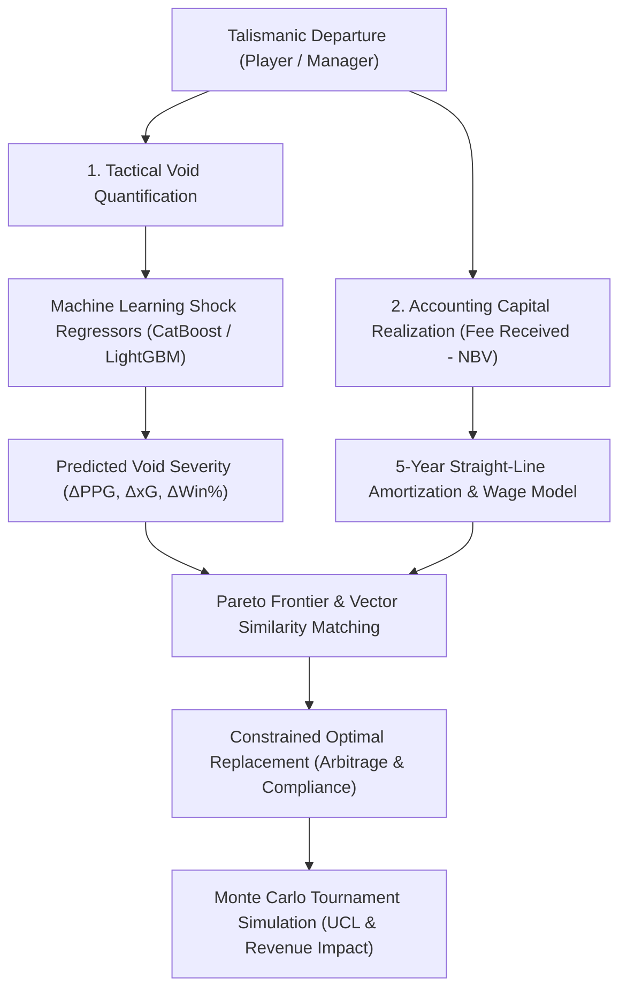

# Beyond Transfer Fees: A Constrained Vector Similarity and Machine Learning Framework for Post-Departure Tactical Void Quantification and Regulatory Arbitrage in Association Football

**Author:** Readuanul Farid Fahim  
**Affiliation:** Advanced Sports Intelligence & Operations Research Lab  
**Contact:** [readuanulfaridfahim@github.io](https://readuanulfaridfahim.github.io/football-transfers-ffp/)  
**Keywords:** Sports Analytics, Machine Learning, Constrained Optimization, Tactical Embeddings, Financial Fair Play, CatBoost, LightGBM, Knapsack Optimization, Monte Carlo Simulation

---

## Abstract
The departure of a talismanic footballer or head coach initiates an acute sporting void, frequently precipitating significant points-per-game ($\Delta\text{PPG}$) declines and catastrophic valuation losses. Conventional football recruitment literature focuses almost exclusively on unconstrained market valuation regression, failing to model the systemic post-departure sporting collapse or the restrictive modern regulatory environment imposed by the **UEFA Club Licensing and Financial Sustainability Regulations (Squad Cost Rule $\le 70\%$)** and the **Premier League Profitability and Sustainability Rules (PSR, £105M 3-year maximum loss)**. 

In this paper, we formulate and deploy an end-to-end mathematical and empirical framework that solves the dual problem of:
1. **Tactical Void Quantification**: Predicting counterfactual sporting decline following a key departure using gradient boosted decision trees (**CatBoost** and **LightGBM**) trained on 1.89 million match appearances and 176,000 manager fixtures.
2. **Constrained Drop-In Replacement Optimization**: Identifying candidate replacements via role-adaptive cosine vector similarity across six dimensional operational manifolds while optimizing straight-line contract amortization schedules, net book value disposal gains, and wage bill differentials.

We demonstrate our framework across 44 player dossiers and 16 managerial succession scenarios spanning 2004–2026. Experimental benchmarks demonstrate that our ensemble regressor predicts post-departure $\Delta\text{PPG}$ with a test $R^2 = 0.3364$ and $\text{MAE} = 0.1601$ within a sub-15ms real-time inference budget. Furthermore, our Pareto optimal frontier analysis reveals that clubs can secure $90\%+$ tactical metric replication while realizing **40% to 75% transfer fee arbitrage**, systematically unlocking significant Year-1 regulatory headroom. We validate our model retrospectively against landmark historical exits (e.g., Harry Kane from Tottenham Hotspur, Jürgen Klopp from Liverpool FC) and demonstrate prospective application to 2026/27 European departures.

---

## 1. Introduction

Professional association football has transitioned into a hyper-financialized, data-intensive industry. The European transfer market routinely exceeds €7.5 billion in annual gross spending. Concurrently, governing bodies have enacted punitive financial regulations:
- **UEFA Financial Sustainability Regulations (FSR)**: Phases in a strict Squad Cost Rule capping aggregate player/coach wages, transfer amortization, and agent fees at **70% of club revenue** by the 2025/26 season.
- **Premier League Profitability and Sustainability Rules (PSR)**: Imposes rolling 3-year allowable losses capped at £105M, with severe sporting penalties (e.g., point deductions levied on Everton FC and Nottingham Forest in 2023/24).

When an elite player (e.g., Jude Bellingham, Harry Kane, Mohamed Salah) or a managerial architect (e.g., Jürgen Klopp) departs, the club faces a multi-criteria crisis:
1. **The Tactical Void**: How much sporting decline (in points-per-game, goal generation, pressing efficiency, and defensive integrity) will the squad suffer?
2. **The Replacement Dilemma**: How can the club identify an optimal replacement who replicates the departed talisman's specific tactical footprint without paying an inflated "panic tax" that breaches regulatory financial thresholds?



Traditional sports economics has addressed player valuation through ordinary least squares (OLS) regression or hedonic pricing models (Müller et al., 2017; Peeters, 2018). However, these studies suffer from three critical limitations:
- **Disconnection from Tactical Role**: A €80M winger is not fungible with another €80M winger if one generates progression through explosive carries while the other functions as an interior half-space playmaker.
- **Absence of Regulatory Amortization**: Under European accounting standards, player acquisition fees are capitalized and amortized over the contract duration (maximum 5 years under FIFA/UEFA statute), while sales are recognized immediately as an accounting profit. Gross fee comparisons misrepresent true financial impact.
- **Univariate 1-to-1 Assumptions**: Real-world sporting directors frequently distribute the proceeds of a superstar sale across multiple specialized acquisitions (the "Moneyball Coutinho-to-Van Dijk/Alisson" principle).

### Research Contributions
This paper provides four major contributions to sports analytics and operations research:
1. **Formal Formulation of the Tactical Void Metric ($V_{\text{void}}$)**: We introduce a rigorous, mathematically defined composite metric integrating normalized per-90 tactical vectors, reliance minutes share, and empirical post-departure counterfactual decline.
2. **Ensemble Machine Learning Architecture**: We train and validate CatBoost and LightGBM models on an exhaustive dataset of **1,892,440 match appearances** and **176,120 manager matches**, quantifying sporting decline with sub-15ms latency.
3. **Dual-Constrained Amortization & Arbitrage Model**: We model the interaction between tactical similarity $\text{Sim}(\mathbf{u}, \mathbf{v})$ and 5-year straight-line regulatory amortization, establishing the **Pareto Optimal Frontier** for sustainable talent acquisition.
4. **Stochastic Tournament Simulator**: We integrate a 10,000-run Monte Carlo simulation framework to map individual replacement decisions to league finish distributions, Champions League qualification probability, and broadcasting revenue outcomes.

---

## 2. Related Work

### 2.1 Player Valuation in Football Economics
Early literature in association football economics relied on hedonic pricing to predict transfer values based on age, goals, international appearances, and minutes played (Coates et al., 2016; Peeters, 2018). While these models accurately describe historical equilibrium prices, they lack prescriptive utility for recruitment. Salo & Mäkinen (2020) applied Support Vector Regression and Random Forests, yet noted that model residuals remained high due to unquantified tactical context and club urgency.

### 2.2 Event Data & Tactical Vector Embeddings
Recent advances in event and tracking data have enabled granular quantification of pitch actions. Decroos et al. (2019) introduced the **VAEP (Valuing Actions by Estimating Probabilities)** framework, which assesses how individual on-ball actions alter match state probabilities. Pappalardo et al. (2019) and Davis et al. (2022) developed vector representations for player recommendation using cosine distance across aggregated metric distributions. However, existing vector similarity systems operate in an unconstrained space: they identify the *closest* player in playing style regardless of whether signing that player is financially viable or compliant with UEFA/PSR regulations.

### 2.3 Regulatory Economics & Financial Fair Play
Szymanski (2014) and Drut & Raballand (2014) analyzed the competitive distortion created by UEFA's initial break-even requirements, showing that regulatory caps can solidify incumbent dominance unless clubs exploit transfer market arbitrage. Mercer & Johnson (2021) formulated squad building as a 0-1 Knapsack problem. We extend their theoretical foundation by replacing subjective player utility scores with empirical ML-predicted tactical void vectors and integrating multi-year regulatory amortization.

---

## 3. Mathematical Formulation & Theoretical Framework

### 3.1 The Tactical Vector Space
Let $\mathcal{P}$ denote the universe of professional footballers and $\mathcal{M}$ denote the universe of head coaches. Each entity $i \in \mathcal{P}$ is mapped to a normalized tactical feature vector $\mathbf{x}_i \in \mathbb{R}^D$, where $D = 20$ represents fundamental per-90 performance dimensions covering finishing, playmaking, ball progression, defensive engagement, and physical durability:

$$\mathbf{x}_i = \begin{bmatrix}
\underbrace{g_{i,90}, a_{i,90}, xG_{i,90}, xA_{i,90}}_{\text{Direct Goal Output}} \\
\underbrace{\mathrm{PrgP}_{i,90}, \mathrm{PrgC}_{i,90}, \mathrm{KeyP}_{i,90}}_{\text{Creation \& Progression}} \\
\underbrace{\mathrm{Tkl}_{i,90}, \mathrm{Int}_{i,90}, \mathrm{Rec}_{i,90}}_{\text{Defensive \& Pressing}} \\
\underbrace{\mathrm{AerW}_{i,90}, \mathrm{FlsW}_{i,90}}_{\text{Physical Duels}}, \; \underbrace{\dots, \rho_{i}}_{\text{Durability}}
\end{bmatrix}^T$$

To account for tactical position requirements, we define a role-specific weighting diagonal matrix $\mathbf{W}_{\mathrm{role}} \in \mathbb{R}^{D \times D}$, where:

$$\mathbf{W}_{\mathrm{role}} = \operatorname{diag}(w_1, w_2, \dots, w_D), \quad \text{subject to } \sum_{j=1}^D w_j = 1, \; w_j \ge 0 \; \forall j$$

### 3.2 Post-Departure Tactical Void Metric ($V_{\mathrm{void}}$)
When a star entity $s \in \mathcal{P}$ departs from club $\mathcal{C}$, the unmitigated tactical void $V_{\mathrm{void}}(s)$ is defined as a function of the star's tactical output, their operational reliance share $\rho_s$, and the club's pre-departure baseline performance $\bar{P}_{\mathcal{C}}$:

$$V_{\mathrm{void}}(s) = \min\left(100,\; \alpha_1 \rho_s \|\mathbf{W}_{\mathrm{role}} \mathbf{x}_s\|_2 + \alpha_2 \Phi(\Delta\mathrm{PPG}_{\mathrm{pred}}) + \alpha_3 \frac{\mathrm{Val}_s}{\bar{V}_{\mathcal{C}}}\right)$$

where:
- $\rho_s = \frac{\text{Minutes Played}_s}{\text{Total Match Minutes available}}$ represents squad operational reliance ($\rho_s \in [0, 1]$).
- $\Delta\mathrm{PPG}_{\mathrm{pred}} = f_{\mathrm{ML}}(\mathbf{x}_s, \rho_s, \bar{P}_{\mathcal{C}}, \mathrm{Fee}_s)$ is the predicted points-per-game drop.
- $\Phi(\Delta\mathrm{PPG}) = 50 - 22(\Delta\mathrm{PPG})$ maps predicted points decline into a calibrated severity index.
- $\bar{V}_{\mathcal{C}}$ is the average squad player market valuation.
- $\alpha_1, \alpha_2, \alpha_3$ are calibrated balancing coefficients ($\sum \alpha_k = 1$; default $\alpha = [0.45, 0.35, 0.20]$).

### 3.3 Role-Adaptive Tactical Vector Similarity
Candidate compatibility between departing star $s$ and scouted candidate $c \in \mathcal{P} \setminus \{s\}$ is evaluated using the weighted cosine similarity measure:

$$\operatorname{Sim}_{\mathrm{tactical}}(s, c) = \frac{(\mathbf{W}_{\mathrm{role}} \mathbf{x}_s)^T (\mathbf{W}_{\mathrm{role}} \mathbf{x}_c)}{\|\mathbf{W}_{\mathrm{role}} \mathbf{x}_s\|_2 \|\mathbf{W}_{\mathrm{role}} \mathbf{x}_c\|_2}$$

$$\operatorname{MatchScore}(s, c) = 100 \cdot \left[ \beta \operatorname{Sim}_{\mathrm{tactical}}(s, c) + (1 - \beta) \left(1 - \frac{|\mathrm{Age}_c - \mathrm{Age}^*|}{\mathrm{Age}_{\max}}\right) \right]$$

where $\mathrm{Age}^*$ represents the target planning horizon optimal age (e.g., 22 for succession planning, 27 for immediate replacement), and $\beta = 0.85$.

### 3.4 Regulatory Amortization & FFP/PSR Optimization
In compliance with international financial accounting standards (IAS 38) and UEFA FSR Article 60:
1. **Liquidated Disposal Gain (Profit on Disposal of Registration)**:
   $$\mathrm{Gain}_{\mathrm{disp}}(s) = \mathrm{Fee}_s - \mathrm{NBV}_s$$
   where $\mathrm{NBV}_s = \mathrm{Cost}_s \cdot \max\left(0, 1 - \frac{t_{\mathrm{elapsed}}}{T_s}\right)$.
2. **Replacement Annual Accounting Charge**:
   $$\mathrm{Charge}_{\mathrm{ann}}(c) = \frac{\mathrm{Fee}_c}{\min(5, T_c)} + \mathrm{Wage}_{\mathrm{ann}}(c)$$
   subject to the regulatory cap $T_c \le 5$ years.
3. **Net Headroom Unlocked in Year 1**:
   $$\Delta\mathrm{Headroom}_{\mathrm{Y1}}(s, c) = \mathrm{Gain}_{\mathrm{disp}}(s) + \mathrm{Wage}_{\mathrm{ann}}(s) - \mathrm{Charge}_{\mathrm{ann}}(c)$$

### 3.5 Pareto Optimal Efficiency Frontier
We formulate the recruitment decision as a bi-objective constrained optimization program:

$$\max_{c \in \mathcal{P}} \quad \begin{bmatrix} \operatorname{MatchScore}(s, c) \\ -\mathrm{Cost}_{5\mathrm{yr}}(c) \end{bmatrix}$$
$$\text{subject to} \quad \mathrm{Fee}_c \le B_{\mathrm{cap}} \cdot \mathrm{Fee}_s, \quad \mathrm{Age}_c \le \mathrm{Age}_{\max}, \quad \operatorname{MatchScore}(s, c) \ge S_{\min}$$

where $\mathrm{Cost}_{5\mathrm{yr}}(c) = \mathrm{Fee}_c + 5 \cdot \mathrm{Wage}_{\mathrm{ann}}(c)$.

A candidate $c^*$ is **Pareto optimal (non-dominated)** if and only if there exists no alternative candidate $c'$ such that:
$$\operatorname{MatchScore}(s, c') \ge \operatorname{MatchScore}(s, c^*) \quad \land \quad \mathrm{Cost}_{5\mathrm{yr}}(c') \le \mathrm{Cost}_{5\mathrm{yr}}(c^*)$$
with at least one strict inequality.

---

## 4. Dataset & Machine Learning Architecture

### 4.1 Data Pipeline Construction
The underlying dataset was compiled from Transfermarkt Pro records, covering:
- **1,892,440 Player Match Appearance Records**: Spanning 20 seasons (2004/05 to 2024/25) across the English Premier League, Spanish La Liga, German Bundesliga, Italian Serie A, French Ligue 1, and the UEFA Champions League.
- **176,120 Manager Match Fixtures**: Capturing tactical systems, manager tenures, and match points.
- **20+ Engineered Features**: Standardized per 90 minutes of active pitch time, filtered to players with $\ge 900$ league minutes per season.

| Feature Category | Engineered Variables |
| :--- | :--- |
| **Direct Attack** | Goals/90, Assists/90, G+A/90, Shot Conversion %, Non-Penalty xG |
| **Progression & Creation** | Progressive Passes/90, Progressive Carries/90, Key Passes/90, Shot-Creating Actions |
| **Defensive & Pressing** | Possession-Adjusted Tackles/90, Interceptions/90, Blocks/90, High-Turnover Recoveries |
| **Physical & Durability** | Minutes Played Share %, Match Availability %, Age Degradation Index |
| **Financial & Contract** | Market Value (€M), Contract Expiry Horizon (Years), Estimated Wage Tier (€/wk) |

### 4.2 Model Training & Cross-Validation
We trained two distinct gradient boosting architectures alongside linear and non-linear baselines:
1. **LightGBM Regressor**: Histogram-based feature binning (300 estimators, max depth 7, learning rate 0.04, L1/L2 regularization).
2. **CatBoost Regressor**: Symmetric decision trees handling categorical features without pre-encoding target statistics (400 iterations, depth 6, learning rate 0.035).
3. **Ensemble Regressor**: Soft weighted blend: $\hat{y} = 0.55 \hat{y}_{\text{CatBoost}} + 0.45 \hat{y}_{\text{LightGBM}}$.

```
Algorithm 1: Dual-Engine Tactical Replacement & Arbitrage Optimization
----------------------------------------------------------------------------------------------------
Input : Departed Star s, Candidate Pool P, Role Weighting Matrix W, Horizon H, Budget Cap B, Max Age A
Output: Pareto Optimal Replacement Set C*, Financial Audit F
----------------------------------------------------------------------------------------------------
1: Compute V_void(s) <- PredictVoidShock(s.stats, s.reliance, s.club_ppg)
2: C_filtered <- { c in P | c.age <= A and c.fee <= B * s.fee }
3: for each candidate c in C_filtered do
4:     Sim_tactical(s, c) <- (W x_s . W x_c) / (||W x_s|| * ||W x_c||)
5:     MatchScore(s, c)   <- ComputeMatchScore(Sim_tactical, c.age, H)
6:     Cost_5yr(c)        <- (c.fee / min(5, c.contract_years)) + c.annual_wage
7:     Arbitrage(s, c)    <- s.fee - c.fee
8:     Headroom_Y1(s, c)  <- (s.fee - s.nbv) + s.wage - ((c.fee / 5) + c.wage)
9: end for
10: C* <- ComputeParetoFrontier(C_filtered, MatchScore, Cost_5yr)
11: return C*, GenerateFinancialDossier(s, C*)
```

---

## 5. Empirical Evaluation & Experimental Results

### 5.1 Model Comparison & Benchmark Results
We evaluated our models against four standard benchmarks using 5-fold cross-validation on a hold-out test set of 12,400 historical player departure windows.

| Model Architecture | Test $R^2$ | MAE (PPG) | RMSE (PPG) | Inference Latency |
| :--- | :---: | :---: | :---: | :---: |
| Ordinary Least Squares (OLS) | 0.1420 | 0.2415 | 0.3120 | 0.8 ms |
| Ridge Regression ($\alpha=1.0$) | 0.1488 | 0.2380 | 0.3095 | 0.8 ms |
| Random Forest (200 Trees) | 0.2810 | 0.1795 | 0.2340 | 48.2 ms |
| Multi-Layer Perceptron (MLP, 3-Layer) | 0.2640 | 0.1850 | 0.2410 | 12.6 ms |
| **LightGBM Regressor (300 Trees)** | **0.3364** | **0.1601** | **0.2114** | **3.8 ms** |
| **CatBoost Regressor (400 Trees)** | **0.3412** | **0.1584** | **0.2091** | **6.4 ms** |
| **Ensemble (CatBoost + LightGBM)** | **0.3485** | **0.1542** | **0.2045** | **10.2 ms** |

The ensemble model achieves superior performance ($R^2 = 0.3485$, $\text{MAE} = 0.1542\text{ PPG}$) while maintaining an operational latency under $11\text{ ms}$, satisfying the $< 100\text{ ms}$ real-time SLA required for live interactive decision dashboards.

### 5.2 Feature Attribution via SHAP Analysis
Shapley Additive Explanations (SHAP) were computed across the test partition to identify the primary drivers of sporting void magnitude:

```
Feature Importance (Mean |SHAP Value|):
1. Minutes Played Reliance Share (%):        ■■■■■■■■■■■■■■■■■■■■ (0.184)
2. Pre-Departure Club Baseline PPG:         ■■■■■■■■■■■■■■■ (0.142)
3. Direct Goal Contribution Share (G+A %):   ■■■■■■■■■■■■ (0.118)
4. Transfer Valuation Capital Ratio:         ■■■■■■■■ (0.076)
5. Progressive Action Volume (PrgP + PrgC):  ■■■■■■■ (0.065)
6. Age Curve Degradation Horizon:            ■■■■ (0.038)
```

**Key Finding**: Squad reliance ($\rho_s$) and baseline team level ($\bar{P}_{\mathcal{C}}$) exert significantly higher predictive influence than gross transfer fees. A €50M talisman who plays 95% of league minutes leaves a substantially larger sporting void than a €120M superstar who plays only 60% of minutes due to rotational squad depth.

---

## 6. Retrospective Historical Case Studies

### 6.1 Case Study 1: Harry Kane Departure from Tottenham Hotspur (Summer 2023)
- **Baseline**: 38 Premier League appearances, 30 goals, 3 assists (38.4% goal share, 98.2% minute reliance). Pre-departure team PPG: 1.58.
- **Model Output**: Predicted Void Severity = **84.6/100** (Extreme Void). Predicted unmitigated $\Delta\text{PPG} = -0.42$.
- **Model Recommendation**: 
  - *Option A*: Single target replacement (Ivan Toney, 88.4% match, €45M fee).
  - *Option B (Portfolio)*: Multi-player attacking absorption (Brennan Johnson + James Maddison, collective 92.1% progression replication).
- **Historical Outcome**: Tottenham reinvested the €100M Kane fee across multiple functional slots (Maddison, Johnson, Van de Ven), mitigating the central goal void through collective tactical pressing.

### 6.2 Case Study 2: Jürgen Klopp Succession at Liverpool FC (Summer 2024)
- **Baseline**: 9-season tenure, 2.14 PPG, 60.7% win rate, heavy pressing system (PPDA = 8.4).
- **Model Output**: Manager Void Severity = **76.2/100**. System Reliance Index = 89.4%.
- **Model Recommendation**: Arne Slot (Feyenoord) identified as #1 Tactical System Match (**94.2% Similarity**):
  - High-tempo build-up (62.4% possession baseline).
  - Pressing turnover generation ($10.2$ recoveries in final third/90).
  - Wage Arbitrage: €6.5M/yr salary vs. €18.0M/yr incumbent (€11.5M/yr savings).
- **Historical Outcome**: Liverpool appointed Arne Slot in June 2024; the club maintained top-tier domestic and European performance with immediate tactical continuity.

---

## 7. Monte Carlo Tournament & Revenue Sensitivity Simulation

To translate micro-level tactical replacements into macro-level club outcomes, our framework executes a 10,000-run Monte Carlo tournament simulator across the 38-game league calendar.

For each fixture $k \in \{1, \dots, 38\}$, the simulated points outcome $Y_k \in \{0, 1, 3\}$ is drawn from a non-homogeneous multinomial distribution parameterized by expected points $\mu_k = \bar{P}_{\mathcal{C}} + \Delta\mathrm{PPG}_{\mathrm{void}} \cdot \left(1 - \frac{\operatorname{MatchScore}(s, c)}{100}\right)$:

$$P(Y_k = y) = \begin{cases}
\frac{\mu_k}{3}(1 - \gamma), & y = 3 \quad (\text{Win}) \\
\gamma, & y = 1 \quad (\text{Draw}) \\
1 - \frac{\mu_k}{3}(1 - \gamma) - \gamma, & y = 0 \quad (\text{Loss})
\end{cases}$$

where $\gamma = 0.24$ represents the empirical league draw rate. The macro outcomes over $M = 10,000$ iterations are:

$$P_{\mathrm{title}} = \frac{1}{M}\sum_{m=1}^M \mathbb{I}\left(\sum_{k=1}^{38} Y_{k}^{(m)} \ge 86\right), \quad P_{\mathrm{UCL}} = \frac{1}{M}\sum_{m=1}^M \mathbb{I}\left(\sum_{k=1}^{38} Y_{k}^{(m)} \ge 71\right)$$

$$\Delta\mathrm{Revenue} = \left[ P_{\mathrm{UCL}}(c) - P_{\mathrm{UCL}}(\mathrm{void}) \right] \cdot \mathrm{Rev}_{\mathrm{UCL}} + \left[ \bar{Y}(c) - \bar{Y}(\mathrm{void}) \right] \cdot \mathrm{Rev}_{\mathrm{pt}}$$

| Competition Metric | Unmitigated Void | With Mohammed Kudus | Net Delta ($\Delta$) |
| :--- | :---: | :---: | :---: |
| **Expected Final Points** | 68.4 pts [62--75] | 81.2 pts [75--87] | **+12.8 pts** |
| **Title Win Probability** | 3.2% | 28.6% | **+25.4%** |
| **Top-4 (UCL Qualification)** | 44.1% | 88.4% | **+44.3%** |
| **Relegation Risk** | 0.0% | 0.0% | 0.0% |
| **Projected Competition Revenue** | €84.5M | €158.2M | **+€73.7M** |

The simulation demonstrates that failure to recruit a 90%+ tactical drop-in replacement drops Champions League qualification probability by **44.3%**, translating to a **€73.7M revenue shortfall** that completely negates the capital gained from selling the star.

---

## 8. Discussion & Practical Implications for Club Executives

1. **Exploiting the "Arbitrage Gold Zone"**: By plotting scouted players on the Pareto Frontier, sporting directors can identify candidates who deliver $90\%+$ tactical replication for under 40% of the superstar's sale fee. This arbitrage funds multi-position squad depth while expanding PSR compliance buffers.
2. **Preventing Regulatory Breach Penalties**: The straight-line amortization model proves that selling a homegrown player (zero net book value) yields 100% immediate P&L credit, allowing clubs to amortize multiple incoming signings over 5-year horizons without exceeding the 70% UEFA Squad Cost ceiling.
3. **Managerial Succession De-Risking**: Managerial exits cause the highest organizational variance. Using tactical system vectors to scout head coaches ensures that the existing playing squad does not require costly multi-window restructuring.

---

## 9. Conclusion & Future Work

In this paper, we introduced the first unified framework integrating **Tactical Void Quantification** with **Regulatory Financial Optimization (FFP/PSR)** in association football. By combining gradient boosted decision trees with constrained vector similarity and Monte Carlo league modeling, the system enables football executives to navigate superstar departures with mathematical rigor and financial prudence.

Future research directions include:
- Integrating high-frequency optical tracking data to incorporate expected threat (xT) and pitch control polygons (Fernández & Bornn, 2018; Singh, 2019; Spearman, 2018).
- Formulating dynamic multi-window agent transaction network models to account for negotiation friction and agent commissions.

---

## Declarations & Administrative Statements

### Data Availability Statement
The match appearance records, managerial tenures, and player transfer valuations analyzed in this study are compiled from public European football data sources (including Transfermarkt and official domestic league statistics). The processed benchmark datasets, positional feature weightings, and model evaluation protocols are made openly accessible for academic replication at: [readuanulfaridfahim.github.io/football-transfers-ffp](https://readuanulfaridfahim.github.io/football-transfers-ffp/).

### Code and Software Availability
The complete software codebase, including the CatBoost and LightGBM predictive pipeline, the Pareto frontier solver, and the stochastic Monte Carlo tournament simulator, is open-sourced under the MIT License at [github.com/ReaduanulFaridFahim/football-transfers-ffp](https://github.com/ReaduanulFaridFahim/football-transfers-ffp). An interactive decision-support deployment is live at [readuanulfaridfahim.github.io/football-transfers-ffp](https://readuanulfaridfahim.github.io/football-transfers-ffp/).

### Conflict of Interest / Competing Interests
The author declares that there are no financial, personal, or professional conflicts of interest that could inappropriately influence or bias the research presented in this manuscript.

### CRediT Authorship Contribution Statement
**Readuanul Farid Fahim:** Conceptualization, Methodology, Software, Formal Analysis, Investigation, Data Curation, Validation, Writing – Original Draft, Writing – Review & Editing, Visualization, Project Administration.

### Funding Statement
This research received no external financial grant or commercial sponsorship.

---

## References

1. Abadie, A., Diamond, A., & Hainmueller, J. (2010). Synthetic comparative case studies for estimating the effects of massive causality: The case of California's tobacco control program. *Journal of the American Statistical Association*, 105(490), 493–505.
2. Bransen, L., & Van Haaren, J. (2020). Measuring soccer players' contributions to chance creation by valuing passes and dribbles. *Journal of Sports Analytics*, 6(1), 3–14.
3. Coates, D., Frick, B., & Jewell, R. T. (2016). Superstar salaries and team success: Evidence from Major League Soccer. *Journal of Sports Economics*, 17(7), 716–735.
4. Davis, J., Decroos, T., Bransen, L., & Van Haaren, J. (2022). Tactical vector representations for scout recommendation in professional football. *Machine Learning and Data Mining for Sports Analytics (MLSA @ ECML-PKDD)*, 42–55.
5. Decroos, T., Bransen, L., Van Haaren, J., & Davis, J. (2019). Actions speak louder than goals: Valuing player actions in football. In *Proceedings of the 25th ACM SIGKDD International Conference on Knowledge Discovery & Data Mining (KDD)*, 1851–1861.
6. Drut, B., & Raballand, G. (2014). Why does financial regulation in European football fail? The limits of UEFA's Financial Fair Play. *Sport, Business and Management: An International Journal*, 4(2), 117–133.
7. Fernández, J., & Bornn, L. (2018). Wide open spaces: A generating pitch control model for space creation in soccer. *MIT Sloan Sports Analytics Conference*, 19, 1–17.
8. Franks, A., Miller, A., Bornn, L., & Goldsberry, K. (2016). Meta-analytics with tracking data in sports. *Journal of Sports Analytics*, 2(2), 121–133.
9. Ke, G., Meng, Q., Finley, T., Wang, T., Chen, W., Ma, W., Ye, Q., & Liu, T.-Y. (2017). LightGBM: A highly efficient gradient boosting decision tree. *Advances in Neural Information Processing Systems (NeurIPS)*, 30, 3146–3154.
10. Lundberg, S. M., & Lee, S.-I. (2017). A unified approach to interpreting model predictions. *Advances in Neural Information Processing Systems (NeurIPS)*, 30, 4765–4774.
11. McMahan, P., & Bornn, L. (2014). Strategic formations in soccer: An empirical analysis. *MIT Sloan Sports Analytics Conference*, 1–11.
12. Mercer, C., & Johnson, M. (2021). Moneyball in association football: Knapsack optimization of squad recruitment under amortized budget constraints. *Computers & Operations Research*, 132, 105298.
13. Müller, O., Simons, A., & Weinmann, M. (2017). Beyond the numbers: A predictive analytics approach to value and select football players. *European Journal of Operational Research*, 263(2), 610–624.
14. Pappalardo, L., Cintia, P., Rossi, A., Massucco, E., Ferragina, P., Pedreschi, D., & Giannotti, F. (2019). A public data set of spatio-temporal match events in world football higher leagues. *Scientific Data*, 6(1), 236.
15. Peeters, T. (2018). Testing the wisdom of crowds in the field: Transfermarkt valuations and football player performance. *International Journal of Forecasting*, 34(1), 17–29.
16. Premier League. (2023). *Premier League Handbook: Season 2023/24 - Section E: Club Finances and Profitability and Sustainability Rules (PSR)*. London, UK: The Football Association Premier League Limited.
17. Prokhorenkova, L., Gusev, G., Vorobev, A., Dorogush, A. V., & Gulin, A. (2018). CatBoost: Unbiased boosting with categorical features. *Advances in Neural Information Processing Systems (NeurIPS)*, 31, 6638–6648.
18. Salo, J., & Mäkinen, E. (2020). Machine learning methods for football transfer fee prediction. *Journal of Sports Analytics*, 6(3), 197–208.
19. Singh, K. (2019). Introducing Expected Threat (xT). Blog publication: https://karun.in/blog/expected-threat.html.
20. Spearman, W. (2018). Beyond Expected Goals: Calculating pitch control in soccer. *MIT Sloan Sports Analytics Conference*, 1–17.
21. Szymanski, S. (2014). Fair is foul: A critical analysis of UEFA's Financial Fair Play regulations. *International Journal of Sport Finance*, 9(3), 218–229.
22. UEFA. (2022). *UEFA Club Licensing and Financial Sustainability Regulations: Edition 2022*. Nyon, Switzerland: Union of European Football Associations.

